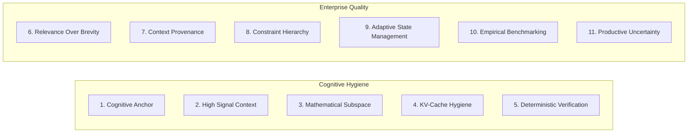

# High-Signal Agent Protocol (HSAP) — Universal Production Specification

> **Specification Standard:** RAHSPS-HSAP v3.1 Enterprise  
> **Applicability:** Software Engineering, Security Architecture, Data Engineering, Autonomous Orchestrators  
> **Core Quality Formula:** $\text{Outcome Quality} \approx f(\text{Objective}, \text{Context}, \text{Constraints}, \text{Model}, \text{Verification})$

---

## 1. Protocol Architecture & Overview

The **High-Signal Agent Protocol (HSAP)** is the operational implementation of RAHSPS. It defines how professional engineers and autonomous AI agents exchange intent, verify reality, maintain invariants, and handle uncertainty across long multi-turn workflows.

Unlike brittle prompt fragments, HSAP establishes a complete interaction lifecycle:
1. **Semantic Anchor:** Early token alignment of non-negotiable invariants and primary outcomes.
2. **Context Provenance:** Explicit separation of verified facts, developer assumptions, and unknowns.
3. **Constraint Hierarchy:** Deterministic resolution of conflicting requirements.
4. **Adaptive Lifecycle:** State curation, hypothesis pruning, and memory hygiene across turns.
5. **Productive Uncertainty Protocol:** Elimination of hallucination when information is missing.

---

## 2. Universal Agent Interaction Matrix (The 11 Pillars)



| Pillar | Principle | Operational Rule |
| :--- | :--- | :--- |
| **Pillar 1** | **Cognitive & Semantic Anchor** | Begin with respectful cognitive address and explicit invariant definitions. |
| **Pillar 2** | **Signal-to-Noise Ratio (SNR)** | Zero unparsed multi-megabyte log dumps; provide structured, filtered reproduction data. |
| **Pillar 3** | **Mathematical Subspace Steering** | Align initial attention tokens with formal engineering literature rather than forum slang. |
| **Pillar 4** | **KV-Cache Hygiene** | Keep session context clean; prune stale assumptions to prevent attention drift. |
| **Pillar 5** | **Deterministic Verification** | Every proposal must include concrete, automated verification commands (DoD). |
| **Pillar 6** | **Relevance Before Brevity** | Evaluate every input by its material impact on the solution, not arbitrary token count. |
| **Pillar 7** | **Context Provenance** | Distinguish verified facts, developer assumptions, model inferences, and unknowns. |
| **Pillar 8** | **Constraint Hierarchy** | Explicit priority order: System Safety > Invariants > Performance > User Convenience. |
| **Pillar 9** | **Adaptive Context Lifecycle** | Maintain active summary of decisions, open questions, and verified facts across turns. |
| **Pillar 10** | **Empirical Evaluation** | Measure and compare prompt strategies through empirical A/B/C/D benchmarks. |
| **Pillar 11** | **Productive Uncertainty** | Never fabricate facts; state unknowns and ask at most one targeted question when blocked. |

---

## 3. The Universal Production Prompt Template

```markdown
### HIGH-SIGNAL AGENT PROTOCOL (HSAP-v3.1)

**Communication Standard:** Maintain a respectful, direct, professional tone. Prioritize task quality and invariants over empty pleasantries.

**1. Primary Objective:**
[Describe the single primary outcome and target deliverable.]

**2. Context & Sources of Truth:**
- Current Environment: [OS, runtime, versions, key file paths]
- Verified Facts: [Code facts confirmed by repo state or logs]
- Assumptions & Hypotheses: [Working assumptions that require verification]
- Unknowns: [Explicitly missing parameters]

**3. Invariants & Constraint Hierarchy:**
- Hierarchy of Authority: Security & Data Integrity > Invariants > Performance > Convenience
- Non-Negotiable Invariants: [What CANNOT be broken: backwards compatibility, API contracts]
- Prohibited Actions: [Forbidden packages, deprecated patterns, file deletions]

**4. Execution Strategy:**
1. Inspect relevant files and ground truth before proposing code.
2. Identify root cause and material risks.
3. Formulate the smallest reliable solution that satisfies the objective.
4. Verify changes through automated test execution.

**5. Productive Uncertainty Protocol:**
- Do NOT invent API methods, parameters, or test results.
- If a missing detail materially blocks safe execution, ask exactly ONE targeted question.
- Otherwise, proceed with explicitly declared safe assumptions.

**6. Definition of Done (DoD) & Acceptance Criteria:**
- [Functional criteria that must pass]
- Verification Command: [e.g., pytest tests/test_auth.py, cargo test, npm test]
```

---

## 4. Dual-Mode Respect & Signal Gate (RSG)

To accommodate both strict security environments and high-velocity developer workflows, RSG supports two operational modes:

### Mode 1: Strict Gate (`--strict`)
- **Use Case:** Autonomous multi-agent pipelines, automated PR review bots, CI linters.
- **Behavior:** Immediately rejects prompts lacking cognitive anchoring or technical context, returning a formal rejection template. Prevents model compute waste on unformulated tasks.

### Mode 2: Adaptive Signal Extraction Mode (`--adaptive`)
- **Use Case:** Interactive human-in-the-loop pairing, developer IDE consoles.
- **Behavior:** When an informal or terse prompt is received, the agent does NOT crash or refuse; instead, it extracts the core intent, categorizes unknowns, formulates safe assumptions, and prompts for missing critical context.
