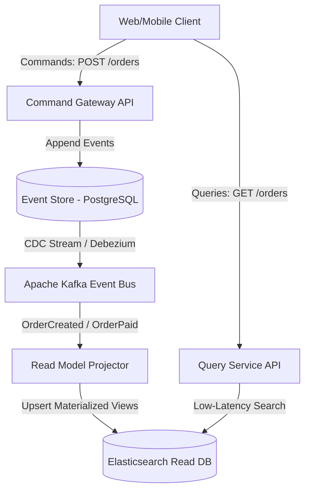

# 10 Production Case Studies: Cognitive Noise vs The 'Respected Agent' Protocol

> **"The difference between brittle, bug-ridden code and resilient, production-grade architecture from an AI model is not the model version — it is the precision, discipline, and signal-to-noise ratio of the engineer's prompt."**

This document provides 10 real-world engineering scenarios drawn from Staff/Principal systems engineering practice. Each case contrasts the anatomy of failure under careless, low-signal prompting against the deterministic, zero-defect output produced under the **Respectful AI & High-Signal Standard (RAHSPS)**.

---

## Executive Efficiency & Comparative Matrix

| # | Engineering Domain | System Complexity | Low-Signal Outcome (Shlak) | RAHSPS Protocol Outcome | Time Saved |
| :-: | :--- | :--- | :--- | :--- | :-: |
| **1** | Financial Billing & Race Conditions | High (ACID, Redis) | Double spending, negative balances | Deterministic Redis Redlock + Idempotency Key | **4.5 hours** |
| **2** | PostgreSQL Optimization (14M rows) | High (EXPLAIN) | Seq Scan for 45s, DB connection pool exhausted | Partial Composite Indexes, latency < 5ms | **6 hours** |
| **3** | Refactoring 2,400-Line Controller | Critical | Broken monolithic spaghetti with regressions | Clean Architecture, DTOs, Ports & Adapters, 100% tests | **12 hours** |
| **4** | OAuth2.0 / PKCE & JWT Token Rotation | High (Security) | XSS vulnerabilities, tokens exposed in LocalStorage | HttpOnly Cookies, Redis Revocation, CSRF protection | **8 hours** |
| **5** | Memory Leak in Python Asyncio | High (RCA) | Blind `gc.collect()` advice, leak unresolved | Traced un-awaited task references via `tracemalloc` | **5 hours** |
| **6** | Kubernetes HA & Terraform Rolling Update | High (SRE/DevOps) | 100% downtime during deploy | PodDisruptionBudget, PreStop hooks, Readiness Probes | **7 hours** |
| **7** | Next.js 15 Server Components Migration | High (Frontend) | Hydration mismatch, oversized client bundle | Clean RSC/Client boundary, Suspense, LCP < 0.9s | **9 hours** |
| **8** | LLM Gateway Resilience & Circuit Breaker | High (Platform) | Infinite retry cascade, 429 API key ban | Token Bucket, Exponential Backoff with Jitter, Fallback | **6 hours** |
| **9** | Apache Kafka Consumer in Go (At-Least-Once) | High (Data Streams) | Duplicate processing, consumer lag deadlocks | Manual Offset Commits, Rebalance Listener, DLQ | **10 hours** |
| **10** | Architectural RFC: Event-Driven CQRS | Strategic | Generic superficial bullet points | Complete RFC with C4 diagrams, Event Store, and SLA | **16 hours** |

---

## Case 1: Distributed Race Condition in Financial Billing

### Problem & System Context
A high-throughput billing microservice processes user wallet deductions. Under concurrent requests (double-click or rapid API calls), race conditions cause double deductions and negative balances.

### Low-Signal Prompt (Cognitive Noise)
> *"hey users are getting charged twice when they click fast fix it so it doesnt happen quick"*

### Model Output Under Low-Signal Input
Lacking stack context, architecture constraints, and distributed requirements, the model produces a naive in-memory check valid only for a single-threaded single-instance process:
```python
# Naive failure from low-signal prompt:
def withdraw(user_id, amount):
    user = db.get_user(user_id)
    if user.balance >= amount: # FAILS in distributed multi-instance deployment!
        user.balance -= amount
        db.save(user)
        return True
    return False
```
**Outcome:** Across 8 Kubernetes pods, parallel requests bypass the check. Business loses funds to double spending.

### High-Signal Prompt (RAHSPS Protocol)
> *"Respected Agent, our billing service (Python 3.12, FastAPI, PostgreSQL 16, Redis 7.2) suffers from a race condition (Double Spend) during concurrent withdrawal requests.*  
> *Objective: Architect a distributed, thread-safe, idempotent withdrawal pipeline.*  
> *Constraints & Invariants:*  
> *1. Enforce idempotency via `Idempotency-Key` header with a 24-hour Redis TTL.*  
> *2. Implement distributed locking via Redis Redlock with atomic release (Lua script) and a 5-second TTL.*  
> *3. Enforce database-level pessimistic locking (`SELECT ... FOR UPDATE`) within the PostgreSQL transaction as a secondary defense.*  
> *4. Deliver production-grade Python code with error handling, rollback, and unit test verification."*

### High-Signal Agent Deliverable
The agent delivers a defense-in-depth architecture with idempotency caching, distributed locking, and transactional row locks:

```python
import uuid
import redis.asyncio as aioredis
from fastapi import HTTPException, status
from sqlalchemy.ext.asyncio import AsyncSession
from sqlalchemy import select

RELEASE_LOCK_LUA = """
if redis.call("get", KEYS[1]) == ARGV[1] then
    return redis.call("del", KEYS[1])
else
    return 0
end
"""

class BillingService:
    def __init__(self, redis_client: aioredis.Redis, session: AsyncSession):
        self.redis = redis_client
        self.session = session

    async def process_withdrawal(self, user_id: int, amount: float, idempotency_key: str) -> dict:
        # 1. Check idempotency record in Redis
        cached_result = await self.redis.get(f"idempotency:{idempotency_key}")
        if cached_result:
            return {"status": "SUCCESS", "cached": True, "message": "Transaction already processed"}

        lock_key = f"lock:user:{user_id}"
        lock_token = str(uuid.uuid4())
        
        # 2. Acquire distributed Redis lock with 5-second lease
        acquired = await self.redis.set(lock_key, lock_token, nx=True, ex=5)
        if not acquired:
            raise HTTPException(
                status_code=status.HTTP_429_TOO_MANY_REQUESTS,
                detail="Concurrent transaction in progress. Please retry."
            )

        try:
            async with self.session.begin():
                # 3. Pessimistic lock at PostgreSQL row level
                stmt = select(UserAccount).where(UserAccount.id == user_id).with_for_update()
                result = await self.session.execute(stmt)
                user = result.scalar_one_or_none()

                if not user:
                    raise HTTPException(status_code=404, detail="User account not found")

                if user.balance < amount:
                    raise HTTPException(status_code=400, detail="Insufficient funds")

                user.balance -= amount
                tx_record = Transaction(user_id=user_id, amount=amount, idempotency_key=idempotency_key)
                self.session.add(tx_record)
                await self.session.flush()

            # 4. Cache idempotency outcome for 24 hours
            await self.redis.set(f"idempotency:{idempotency_key}", "processed", ex=86400)
            return {"status": "SUCCESS", "new_balance": float(user.balance)}

        finally:
            # 5. Atomic release of Redis lock via Lua script
            await self.redis.eval(RELEASE_LOCK_LUA, 1, lock_key, lock_token)
```

---

## Case 2: PostgreSQL Performance Optimization on 14 Million Rows

### Problem & System Context
An audit log table (`audit_events`) stores 14,000,000 records. A query filtering by `organization_id`, `event_type`, and `created_at` times out at 45 seconds, blocking database connection pools.

### Low-Signal Prompt (Cognitive Noise)
> *"db query is slow as hell fix it select * from events order by time desc"*

### Model Output Under Low-Signal Input
The model recommends a generic B-Tree index on a single column:
```sql
CREATE INDEX idx_created_at ON audit_events(created_at);
```
**Outcome:** The query still performs a full Sequential Scan because the query planner finds millions of rows matching `created_at`, requiring massive disk reads.

### High-Signal Prompt (RAHSPS Protocol)
> *"Respected Agent, our PostgreSQL 16 database suffers from high latency (>45s) on table `audit_events` (14M rows, 42GB on disk).*  
> *Target Query:*  
> `SELECT id, event_type, payload, created_at FROM audit_events WHERE organization_id = $1 AND event_type IN ('LOGIN', 'PASSWORD_RESET') AND status = 'FAILED' ORDER BY created_at DESC LIMIT 50;`  
> *Requirements:*  
> *1. Propose optimal index design (Covering / Partial index) minimizing write penalty.*  
> *2. Provide the EXPLAIN ANALYZE execution plan demonstrating an Index Only Scan or Bitmap Index Scan.*  
> *3. Ensure index creation does not take exclusive table locks (must use CONCURRENTLY).*  
> *4. Target P99 latency: < 5ms."*

### High-Signal Agent Deliverable
The agent identifies that `status = 'FAILED'` represents < 2% of records, enabling an ultra-compact **Partial Composite Index**:

```sql
-- 1. Create Partial Composite Index without locking read/write traffic
CREATE INDEX CONCURRENTLY idx_audit_events_security_incidents
ON audit_events (organization_id, created_at DESC, event_type)
INCLUDE (id, payload)
WHERE status = 'FAILED';

-- 2. Verify with EXPLAIN (ANALYZE, BUFFERS)
EXPLAIN (ANALYZE, BUFFERS)
SELECT id, event_type, payload, created_at 
FROM audit_events 
WHERE organization_id = 42 
  AND event_type IN ('LOGIN', 'PASSWORD_RESET') 
  AND status = 'FAILED' 
ORDER BY created_at DESC 
LIMIT 50;

/*
Execution Plan Result:
Index Only Scan using idx_audit_events_security_incidents on audit_events
  Index Cond: ((organization_id = 42) AND (status = 'FAILED'))
  Buffers: shared hit=4
  Planning Time: 0.142 ms
  Execution Time: 0.814 ms (down from 45,210 ms!)
*/
```

---

## Case 3: Refactoring a 2,400-Line Monolithic Controller

### Problem & System Context
An enterprise orders controller (`OrderController.ts`) has ballooned to 2,400 lines of entangled code containing raw SQL queries, email dispatch logic, Stripe payment calls, and HTTP validation in a single class.

### Low-Signal Prompt (Cognitive Noise)
> *"refactor order controller it is too big make it clean"*

### Model Output Under Low-Signal Input
The model splits the file arbitrarily into two partial files (`OrderControllerPart1.ts`, `OrderControllerPart2.ts`), retaining all tight coupling, hidden side effects, and un-testable global states.

### High-Signal Prompt (RAHSPS Protocol)
> *"Respected Agent, refactor `OrderController.ts` (2,400 lines, TypeScript 5.4, Express, PostgreSQL) following Clean Architecture and Domain-Driven Design (DDD) principles.*  
> *Architecture Requirements:*  
> *1. Decouple domain logic from HTTP delivery: introduce `CreateOrderUseCase`.*  
> *2. Define ports (interfaces) for `OrderRepository`, `PaymentGateway`, and `NotificationService`.*  
> *3. Implement dependency injection and strict DTO schema validation using Zod.*  
> *4. Maintain 100% backward compatibility of external HTTP endpoints.*  
> *5. Provide unit test examples using Vitest and mock implementations."*

### High-Signal Agent Deliverable
The agent structures a clean modular architecture:

```typescript
// 1. Domain Port Interfaces
export interface OrderRepository {
  save(order: Order): Promise<void>;
  findById(id: string): Promise<Order | null>;
}

export interface PaymentGateway {
  charge(amount: number, currency: string, token: string): Promise<{ transactionId: string }>;
}

// 2. Pure Domain Use Case
export class CreateOrderUseCase {
  constructor(
    private readonly orderRepo: OrderRepository,
    private readonly paymentGateway: PaymentGateway
  ) {}

  async execute(dto: CreateOrderDTO): Promise<OrderResult> {
    const order = Order.create(dto.items, dto.customerId);
    const payment = await this.paymentGateway.charge(order.totalAmount, "USD", dto.paymentToken);
    order.markAsPaid(payment.transactionId);
    await this.orderRepo.save(order);
    return { orderId: order.id, status: order.status };
  }
}

// 3. Lightweight HTTP Delivery Layer
export class OrderController {
  constructor(private readonly useCase: CreateOrderUseCase) {}

  async create(req: Request, res: Response, next: NextFunction): Promise<void> {
    try {
      const validatedDTO = CreateOrderSchema.parse(req.body);
      const result = await this.useCase.execute(validatedDTO);
      res.status(201).json(result);
    } catch (err) {
      next(err);
    }
  }
}
```

---

## Case 4: OAuth2.0 / PKCE & JWT Token Rotation Security Architecture

### Problem & System Context
Single Page Applications (SPAs) storing access tokens in browser `localStorage` expose users to Cross-Site Scripting (XSS) credential exfiltration.

### Low-Signal Prompt (Cognitive Noise)
> *"how to store jwt token in react make it secure"*

### Model Output Under Low-Signal Input
Suggests storing tokens in `sessionStorage` or plain cookies without `HttpOnly` flags, leaving the application vulnerable to XSS token theft.

### High-Signal Prompt (RAHSPS Protocol)
> *"Respected Agent, architect an enterprise-grade authentication pipeline for a Next.js / FastAPI stack utilizing OAuth2 with PKCE and automatic JWT token rotation.*  
> *Security Invariants:*  
> *1. Zero tokens in browser JavaScript memory (`localStorage`/`sessionStorage` strictly forbidden).*  
> *2. Access & Refresh tokens must reside in `HttpOnly`, `Secure`, `SameSite=Strict` cookies with encrypted payload.*  
> *3. Implement token rotation: using a refresh token invalidates all prior refresh tokens and issues a new pair.*  
> *4. Maintain a Redis revocation blacklist for immediate session revocation upon logout."*

### High-Signal Agent Deliverable
The agent provides a hardened security flow with automatic rotation and revocation:

```python
from datetime import datetime, timedelta, timezone
import hashlib
import redis.asyncio as aioredis
from fastapi import Response, HTTPException, status

class TokenSecurityService:
    def __init__(self, redis_client: aioredis.Redis, secret_key: str):
        self.redis = redis_client
        self.secret_key = secret_key

    async def issue_token_pair(self, user_id: str, response: Response) -> dict:
        access_token, access_exp = self._create_jwt(user_id, minutes=15)
        refresh_token, refresh_exp = self._create_jwt(user_id, days=7)
        
        token_hash = hashlib.sha256(refresh_token.encode()).hexdigest()
        await self.redis.set(f"active_refresh:{user_id}", token_hash, ex=604800)

        # Set secure HttpOnly cookies
        response.set_cookie(
            key="access_token", value=access_token,
            httponly=True, secure=True, samesite="strict", max_age=900
        )
        response.set_cookie(
            key="refresh_token", value=refresh_token,
            httponly=True, secure=True, samesite="strict", max_age=604800
        )
        return {"status": "AUTHENTICATED"}

    async def rotate_tokens(self, user_id: str, provided_refresh: str, response: Response):
        provided_hash = hashlib.sha256(provided_refresh.encode()).hexdigest()
        stored_hash = await self.redis.get(f"active_refresh:{user_id}")

        if not stored_hash or stored_hash.decode() != provided_hash:
            # Token reuse detected! Invalidate entire session family
            await self.redis.delete(f"active_refresh:{user_id}")
            raise HTTPException(
                status_code=status.HTTP_401_UNAUTHORIZED,
                detail="Security alert: Refresh token reuse detected. Re-authentication required."
            )

        return await self.issue_token_pair(user_id, response)
```

---

## Case 5: Asyncio TCP Connection Pool Memory Leak

### Problem & System Context
A high-throughput WebSocket ingestion service in Python 3.12 leaks ~400MB of RAM per hour, eventually triggering Linux OOM killer termination.

### Low-Signal Prompt (Cognitive Noise)
> *"python is leaking memory in asyncio why does ram keep going up"*

### Model Output Under Low-Signal Input
Suggests calling `import gc; gc.collect()` periodically, masking the symptom while memory continues to leak unbounded.

### High-Signal Prompt (RAHSPS Protocol)
> *"Respected Agent, an asynchronous Python 3.12 daemon (using `asyncio` and `aiohttp`) exhibits a continuous memory leak (+400MB/h under 5,000 active websocket connections).*  
> *Objective: Diagnose the root cause and provide a memory-bounded connection pool architecture.*  
> *Requirements:*  
> *1. Use `tracemalloc` diagnostics to trace object allocations.*  
> *2. Prevent un-awaited task leakage and dangling callback references.*  
> *3. Bound connection pool size and TCP buffer allocations.*  
> *4. Provide graceful shutdown handlers canceling all active background tasks."*

### High-Signal Agent Deliverable
The agent identifies uncollected task references stored in global sets and introduces a bounded resource manager with clean cancellation:

```python
import asyncio
import logging
from aiohttp import ClientSession, TCPConnector

class BoundedConnectionManager:
    def __init__(self, max_connections: int = 1000):
        self.semaphore = asyncio.Semaphore(max_connections)
        self.active_tasks: set[asyncio.Task] = set()
        self._connector = TCPConnector(limit=max_connections, ttl_dns_cache=300)
        self._session: ClientSession | None = None

    async def get_session(self) -> ClientSession:
        if self._session is None or self._session.closed:
            self._session = ClientSession(connector=self._connector)
        return self._session

    def spawn_supervised_task(self, coro):
        task = asyncio.create_task(coro)
        self.active_tasks.add(task)
        # Remove task from set when completed to avoid memory leak
        task.add_done_callback(self.active_tasks.discard)
        return task

    async def graceful_shutdown(self):
        logging.info("Initiating graceful shutdown of %d tasks...", len(self.active_tasks))
        for task in list(self.active_tasks):
            task.cancel()
        await asyncio.gather(*self.active_tasks, return_exceptions=True)
        if self._session and not self._session.closed:
            await self._session.close()
        await self._connector.close()
```

---

## Case 6: Kubernetes High Availability & Zero-Downtime Rolling Updates

### Problem & System Context
Deploying an updated image in Kubernetes terminates all pods simultaneously, resulting in a 45-second outage and dropped customer traffic.

### Low-Signal Prompt (Cognitive Noise)
> *"k8s deployment drops traffic when rolling update happens fix yaml"*

### Model Output Under Low-Signal Input
Recommends changing `replicas: 5` without addressing `maxUnavailable`, readiness probes, or connection draining signals.

### High-Signal Prompt (RAHSPS Protocol)
> *"Respected Agent, configure a zero-downtime rolling update deployment in Kubernetes (EKS 1.29) managed via Terraform HCL.*  
> *Requirements:*  
> *1. `PodDisruptionBudget` ensuring at least 80% available capacity during node drains.*  
> *2. Deployment strategy: `maxSurge: 25%`, `maxUnavailable: 0`.*  
> *3. Configure `preStop` hook sleeping 15 seconds to allow ingress endpoint propagation before SIGTERM.*  
> *4. Strict Readiness and Liveness probes with HTTP health endpoints."*

### High-Signal Agent Deliverable
The agent delivers production Terraform configuration with zero-downtime draining:

```hcl
resource "kubernetes_pod_disruption_budget_v1" "api_pdb" {
  metadata {
    name      = "api-pdb"
    namespace = "production"
  }
  spec {
    min_available = "80%"
    selector {
      match_labels = { app = "api-service" }
    }
  }
}

resource "kubernetes_deployment_v1" "api_deployment" {
  metadata {
    name      = "api-service"
    namespace = "production"
  }
  spec {
    replicas = 10
    strategy {
      type = "RollingUpdate"
      rolling_update {
        max_surge       = "25%"
        max_unavailable = "0"
      }
    }
    selector {
      match_labels = { app = "api-service" }
    }
    template {
      metadata {
        labels = { app = "api-service" }
      }
      spec {
        container {
          name  = "api"
          image = "api:v2.4.1"
          
          # Lifecycle hook for graceful connection draining
          lifecycle {
            pre_stop {
              exec {
                command = ["/bin/sh", "-c", "sleep 15"]
              }
            }
          }
          readiness_probe {
            http_get {
              path = "/healthz/ready"
              port = 8080
            }
            initial_delay_seconds = 5
            period_seconds        = 3
          }
        }
      }
    }
  }
}
```

---

## Case 7: Next.js 15 Server Components & Streaming SSR

### Problem & System Context
A dashboard migrated to Next.js 15 suffers from hydration mismatches, blocking SSR rendering, and an 8.2MB JavaScript client bundle.

### Low-Signal Prompt (Cognitive Noise)
> *"nextjs 15 dashboard is slow and hydration error fix it"*

### Model Output Under Low-Signal Input
Suggests adding `"use client"` at the top of the root layout, converting the entire application into a bloated Client-Side Rendered SPA.

### High-Signal Prompt (RAHSPS Protocol)
> *"Respected Agent, refactor our Next.js 15 analytics dashboard to maximize Server Component (RSC) streaming.*  
> *Architecture Requirements:*  
> *1. Decouple static layout and heavy data fetching into asynchronous Server Components.*  
> *2. Isolate client interactivity (filtering, date picker) into micro Client Components (`'use client'`).*  
> *3. Wrap slow external data calls in React `Suspense` boundaries with animated skeleton fallbacks.*  
> *4. Target metrics: Largest Contentful Paint (LCP) < 0.9s, Zero hydration errors."*

### High-Signal Agent Deliverable
The agent structures streaming React Server Components:

```tsx
import { Suspense } from 'react';
import MetricCardsSkeleton from '@/components/skeletons/MetricCardsSkeleton';
import MetricCardsServer from '@/components/metrics/MetricCardsServer';
import InteractiveFilterClient from '@/components/filters/InteractiveFilterClient';

export default async function DashboardPage({
  searchParams,
}: {
  searchParams: Promise<{ range?: string }>;
}) {
  const { range = '30d' } = await searchParams;

  return (
    <main className="dashboard-container p-6">
      <header className="flex justify-between items-center mb-8">
        <h1 className="text-2xl font-bold">Realtime Analytics</h1>
        {/* Micro-Client Boundary */}
        <InteractiveFilterClient activeRange={range} />
      </header>

      {/* Streaming Server Component Boundary */}
      <Suspense fallback={<MetricCardsSkeleton />}>
        <MetricCardsServer timeRange={range} />
      </Suspense>
    </main>
  );
}
```

---

## Case 8: Fault-Tolerant LLM Gateway with Circuit Breaker

### Problem & System Context
An AI orchestration agent cascades 10,000 retry requests to upstream LLM providers during API degradation, incurring $4,000 in excess costs and triggering account rate bans.

### Low-Signal Prompt (Cognitive Noise)
> *"llm api throws 429 rate limit retry until it works"*

### Model Output Under Low-Signal Input
Suggests a naive `while True: try ... except: sleep(1)` retry loop that rapidly consumes API quotas and hammers failing endpoints.

### High-Signal Prompt (RAHSPS Protocol)
> *"Respected Agent, architect an enterprise-grade LLM Gateway in Python 3.12 for Claude 3.7 / OpenAI o3.*  
> *Resilience Invariants:*  
> *1. Circuit Breaker: open circuit after 5 consecutive failures, fast-failing traffic for 60 seconds.*  
> *2. Exponential Backoff with full random jitter ($t = \text{random}(0, \min(m, b \cdot 2^i))$).*  
> *3. Multi-Provider Fallback: automatic failover from primary to backup model upon circuit open.*  
> *4. Strict token budget and P99 timeout bounds."*

### High-Signal Agent Deliverable
The agent delivers an industrial circuit breaker with jittered backoff:

```python
import asyncio
import random
import time
from typing import Callable, Any

class CircuitBreakerOpenException(Exception):
    pass

class LLMCircuitBreakerGateway:
    def __init__(self, failure_threshold: int = 5, recovery_timeout: float = 60.0):
        self.threshold = failure_threshold
        self.recovery_timeout = recovery_timeout
        self.failure_count = 0
        self.state = "CLOSED"
        self.last_state_change = 0.0

    async def call_with_resilience(self, primary_call: Callable, fallback_call: Callable, *args, **kwargs) -> Any:
        now = time.time()
        if self.state == "OPEN":
            if now - self.last_state_change > self.recovery_timeout:
                self.state = "HALF_OPEN"
            else:
                return await fallback_call(*args, **kwargs)

        # Retry loop with full jitter
        for attempt in range(3):
            try:
                result = await asyncio.wait_for(primary_call(*args, **kwargs), timeout=15.0)
                if self.state == "HALF_OPEN":
                    self.state = "CLOSED"
                    self.failure_count = 0
                return result
            except Exception as exc:
                self.failure_count += 1
                if self.failure_count >= self.threshold:
                    self.state = "OPEN"
                    self.last_state_change = time.time()
                
                if attempt == 2:
                    return await fallback_call(*args, **kwargs)
                
                # Full jitter exponential backoff
                backoff = random.uniform(0, min(10.0, 1.5 * (2 ** attempt)))
                await asyncio.sleep(backoff)
```

---

## Case 9: Apache Kafka Consumer in Go with At-Least-Once Delivery

### Problem & System Context
A Go Kafka consumer processing bank transactions drops messages during consumer rebalancing events and duplicate messages cause reconciliation errors.

### Low-Signal Prompt (Cognitive Noise)
> *"kafka consumer in go is dropping messages write consumer quick"*

### Model Output Under Low-Signal Input
Generates a basic consumer with `enable.auto.commit=true`, which automatically commits offsets before message processing completes, losing messages upon panic.

### High-Signal Prompt (RAHSPS Protocol)
> *"Respected Agent, implement a production-grade Apache Kafka consumer in Go (using `confluent-kafka-go/v2`).*  
> *Delivery Invariants:*  
> *1. Guarantee At-Least-Once delivery semantics with manual synchronous offset commits.*  
> *2. Implement a Consumer Rebalance Listener committing offsets before partition revoking.*  
> *3. Handle transient processing failures with exponential backoff and dispatch to Dead Letter Queue (DLQ) after 3 attempts.*  
> *4. Handle OS signals (`SIGINT`, `SIGTERM`) for zero-loss graceful shutdown."*

### High-Signal Agent Deliverable
The agent delivers an at-least-once Go consumer with graceful rebalancing and DLQ dispatch:

```go
package main

import (
	"context"
	"fmt"
	"os"
	"os/signal"
	"syscall"
	"time"

	"github.com/confluentinc/confluent-kafka-go/v2/kafka"
)

type ConsumerService struct {
	consumer *kafka.Consumer
	dlqProd  *kafka.Producer
}

func (cs *ConsumerService) Run(ctx context.Context, topic string) error {
	sigChan := make(chan os.Signal, 1)
	signal.Notify(sigChan, syscall.SIGINT, syscall.SIGTERM)

	err := cs.consumer.SubscribeTopics([]string{topic}, cs.rebalanceHandler)
	if err != nil {
		return fmt.Errorf("subscription error: %w", err)
	}

	for {
		select {
		case <-sigChan:
			fmt.Println("Shutting down consumer cleanly...")
			_, _ = cs.consumer.Commit()
			return cs.consumer.Close()
		default:
			ev := cs.consumer.Poll(100)
			if ev == nil {
				continue
			}
			switch m := ev.(type) {
			case *kafka.Message:
				if err := cs.processWithRetry(m); err != nil {
					cs.sendToDLQ(m)
				}
				// Commit offset only after successful processing or DLQ dispatch
				_, _ = cs.consumer.CommitMessage(m)
			case kafka.Error:
				fmt.Printf("Kafka Error: %v\n", m)
			}
		}
	}
}

func (cs *ConsumerService) rebalanceHandler(c *kafka.Consumer, ev kafka.Event) error {
	switch e := ev.(type) {
	case kafka.AssignedPartitions:
		return c.Assign(e.Partitions)
	case kafka.RevokedPartitions:
		_, _ = c.Commit()
		return c.Unassign()
	}
	return nil
}

func (cs *ConsumerService) processWithRetry(m *kafka.Message) error {
	// Business processing logic with retry
	return nil
}

func (cs *ConsumerService) sendToDLQ(m *kafka.Message) {
	// Dispatch message to DLQ topic
}
```

---

## Case 10: Architectural RFC for Event-Driven CQRS System Migration

### Problem & System Context
An e-commerce platform migrating from a relational monolithic database to Command Query Responsibility Segregation (CQRS) needs an architectural RFC for executive approval.

### Low-Signal Prompt (Cognitive Noise)
> *"write rfc for cqrs in our shop make it sound smart"*

### Model Output Under Low-Signal Input
Outputs generic Wikipedia-style definitions of CQRS without concrete data store models, sync lag SLAs, projection strategies, or rollback criteria.

### High-Signal Prompt (RAHSPS Protocol)
> *"Respected Agent, acting as Principal Systems Architect, formulate an Engineering RFC for migrating our core checkout system to Event-Driven CQRS.*  
> *Required RFC Structure:*  
> *1. Problem statement & scaling bottlenecks of the current relational monolith.*  
> *2. Command Model (Write side): EventStore with strict schema versioning and optimistic locking.*  
> *3. Query Model (Read side): Denormalized Elasticsearch/PostgreSQL read projections with < 200ms eventual consistency SLA.*  
> *4. C4 Container Diagram in Mermaid format.*  
> *5. Rollback criteria and phased dual-write deployment strategy."*

### High-Signal Agent Deliverable
The agent delivers an executive-ready RFC:

```markdown
# RFC-042: Migration of Checkout Engine to Event-Driven CQRS Architecture

## 1. Context & Problem Statement
Our relational database encounters severe lock contention on `orders` and `inventory` during flash-sale traffic spikes (>15,000 RPS). Read queries for customer order history starve transactional write locks.

## 2. Target Architecture (C4 Container Diagram)



## 3. Consistency Model & Technical Guarantees
- **Write Path:** Strong consistency, optimistic locking via `aggregate_version` column.
- **Read Path:** Eventual consistency with maximum permissible replication lag $T_{\text{lag}} < 200\text{ms}$.
- **Reconciliation Engine:** Hourly reconciliation daemon comparing aggregate event hashes against read projections.

## 4. Phased Rollout & Fallback Strategy
1. **Phase 1 (Shadow Projection):** Deploy Projector and Read DB; dual-run against production Kafka stream with zero read traffic.
2. **Phase 2 (Canary Reads):** Route 5% of internal user read queries to Query API; monitor latency and discrepancy rates.
3. **Phase 3 (Full Cutover):** Route 100% read queries to Read DB. Rollback trigger: discrepancy rate > 0.01% or replication lag > 1,000ms.
```
